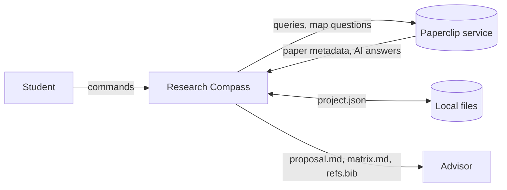
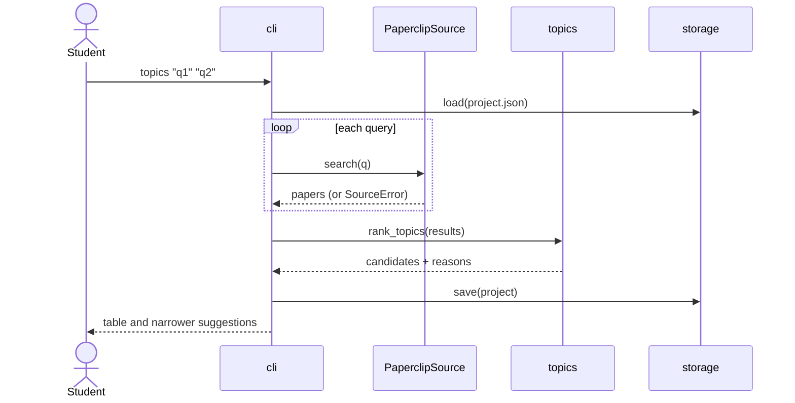
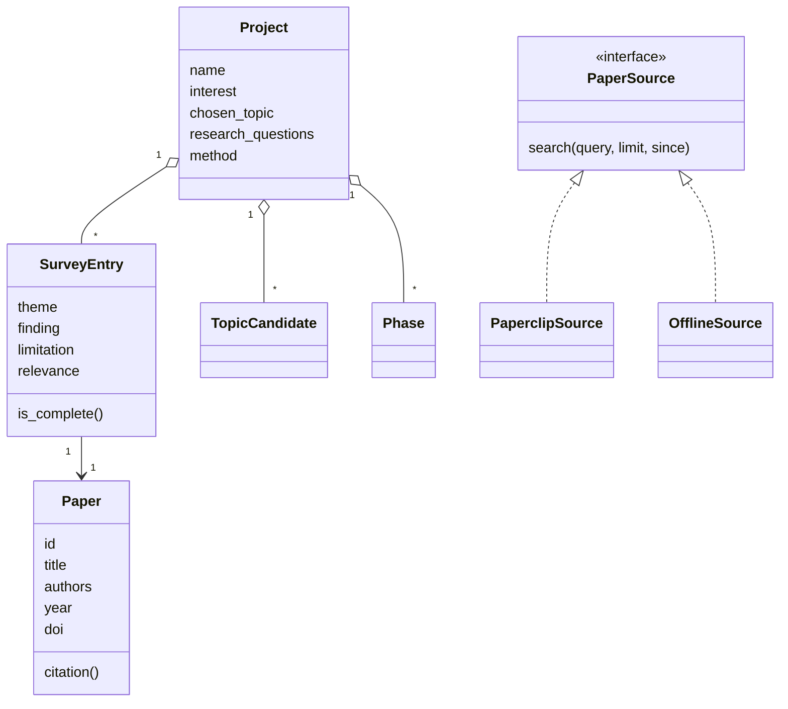

# Team Workbook: Research Compass

Copied from `docs/TEAM_WORKBOOK.md`. Each section = one Sommerville phase.

> **Status: AI first draft (2026-11-11).** Claude drafted every entry below. Each entry needs a named
> human owner who has read it, corrected it, and initialled it. Replace every `[__]` and `<team: ...>`.
> Items marked ⚠ are guesses about your team that only you can confirm.

**Team name:** <team: name>  **App:** Research Compass (topic finding, literature survey, proposal drafting for graduate students)
**Members & roles:** <team: Name – Product Owner>, <Name – Scrum master (rotates)>, <Name – Architect>, <Name – Quality lead>, <Name – Prompt engineer>

---
## 0. Charter (Ch 2, 3) · 2026-11-11 · [__]
- **Process model chosen and why:** Incremental, agile (Scrum-lite) with three short sprints. The requirements are only partly known (we do not yet know how students rate the topic scores, or whether a terminal UI is acceptable), so we need working increments to show users early. We keep a few plan-driven documents (brief, requirements, architecture) because the course grades them and se-agent reads them.
- **Agile practices we use:** ☑ user stories ☑ sprints ☑ daily stand-up (3 lines in the Issue thread on non-class days) ☑ retrospective ☑ pair/peer review ☑ CI tests ⚠ (CI needs a GitHub Actions workflow running `cd app && pytest`; not yet added)
- **Definition of Done:**
  ☐ Code merged through a PR reviewed by one other member
  ☐ `cd app && pytest` passes, and a new test covers the change
  ☐ The new test was seen to fail with the feature broken
  ☐ Requirement row and test row in this workbook updated
  ☐ README updated if a command or flag changed
  ☐ No keys, tokens, or personal data in the diff
- **How we communicate / meeting times:** ⚠ <team: channel (e.g., Discord/Teams)>, stand-up <day/time>, sprint review in class.
- **How we resolve disagreements:** Discuss for 10 minutes with evidence (a test, a user comment, a requirement). If still split, the role owner decides (Architect for structure, Product Owner for scope, Quality lead for Done). Record the decision in §3's log.
- **AI-use rules we agree to (Guide §5):** AI drafts, a named human owns. Every deliverable has an "AI contribution" note. No keys, personal data, or instructor-only material in prompts or briefs. AI-written tests must be shown to fail when the code is broken. The in-app AI reader's output is always saved as a labelled draft and never written into notes automatically.

## 1. Requirements (Ch 4) · 2026-11-11 · [__]
| ID | Type (F/NF) | Requirement | Priority | Acceptance test | Owner |
|---|---|---|---|---|---|
| R1 | F | Create a project (name + interest) stored in one JSON file | Must | `init` creates file; `init` again without `--force` errors and leaves it unchanged | [__] |
| R2 | F | Compare 1–8 candidate topics; show score 0–100, verdict, and reasons | Must | Demo topics rank federated-learning first; each shows 4 reasons | [__] |
| R3 | F | <5 hits → "too narrow" (ranked last); ≥40% review titles → "saturated" | Must | Hallucination demo topic shows "saturated" | [__] |
| R4 | F | Suggest narrower wordings from title phrases that repeat in ≥2 papers | Should | Two titles sharing "client drift" give "federated client drift" | [__] |
| R5 | F | Search Paperclip, list numbered results, add chosen ones; skip duplicates by id, DOI, or title | Must | Adding the same paper twice reports "skipped 1 duplicate" | [__] |
| R6 | F | Notes per paper: theme, method, finding, limitation, relevance 1–5 | Must | Relevance 0, 6, or −1 errors and leaves relevance unchanged | [__] |
| R7 | F | Export literature matrix and theme-grouped outline with a gaps section | Must | Matrix has one row per paper; `\|` in text does not break the table | [__] |
| R8 | F | Coverage report: <10 papers, missing notes, single-paper themes, nothing recent, no limitations | Must | Project with one old, unnoted paper gets all five warnings | [__] |
| R9 | F | Proposal draft with all sections, author-year citations, timeline totals, references; TODO for gaps | Must | Phases 4, 8, 4 weeks → "Total: 16 weeks." | [__] |
| R10 | F | BibTeX export with unique keys | Must | Three same-author same-year papers get keys …, …b, …c | [__] |
| R11 | F | Optional AI reader (Paperclip `map`) saved as a labelled draft file | Should | Offline mode prints a clear error; fake client returns final text | [__] |
| R12 | NF (reliability) | Any error: message on stderr, exit code 1, project file unchanged | Must | Bad `add`, `note`, `plan`, `init` leave file byte-identical | [__] |
| R13 | NF (availability/testability) | `--offline` mode with bundled fictional data; all tests run with no network or account | Must | `pytest` passes with network disabled | [__] |
| R14 | NF (security/privacy) | API key only from `paperclip login` or env var; never stored in project file or repo | Must | Project JSON contains no key fields; review checklist item | [__] |
| R15 | NF (usability) | Missing login gives a sign-in hint instead of a traceback | Must | Fake `AuthError` → message contains "paperclip login" | [__] |
| R16 | NF (maintainability) | Logic separated from CLI; Paperclip behind an adapter | Must | Logic modules import nothing from `cli.py`; tests use a fake client | [__] |
| R17 | NF (data integrity) | Saves are atomic; damaged or wrong-version files give a clear error | Must | Corrupt JSON / version 99 / bad entry each raise a readable error | [__] |

- **Stakeholders & what each wants:** *Graduate student:* a defensible topic quickly and less bookkeeping during reading. *Advisor:* evidence the topic is open and the survey is broad enough. *Course instructor:* traceable SE process and controlled AI cost. *Paperclip (service provider):* use within auth and rate limits.
- **Ambiguities / questions for the customer:** Are the score weights right, and should students be able to change them? Is Paperclip's coverage (biomedical + arXiv) acceptable for students in other fields? Is a terminal UI acceptable? Does the proposal need a department template? What counts as "recent" in slow-moving fields?
- **Requirements removed as unnecessary and why (YAGNI):** Web UI (doubles the work; CLI tests the core idea first). Full-text PDF reading (Paperclip already does this server-side). Multiple citation styles (author-year is enough for a draft). Accounts and sharing (single user).
- **AI contribution note:** Claude drafted all requirements from the team's one-line goal and the Paperclip README. ⚠ Team to record what was changed after the customer interview.

## 2. Models (Ch 5) · 2026-11-11 · [__]
- **Context model:** inside the system: CLI, topic scoring, survey, proposal, JSON storage. Outside: the student, the Paperclip service (search and `map`), the local file system, and the advisor (reads exported files).

- **Use cases / sequence model:** Use cases: UC1 compare topics, UC2 build survey, UC3 take notes, UC4 check coverage, UC5 generate proposal, UC6 ask AI reader.

- **Class (structural) model:**

- **State (behavioral) model:** a survey entry moves from *added* → *partly noted* → *complete* (has theme, finding, and relevance). A project moves from *created* → *topics compared* → *topic chosen* → *surveying* → *proposal ready* (when `readiness()` returns no problems). Any state can go back (e.g., re-choose a topic).
- **Inconsistencies found and how resolved:** (1) R5 said duplicates are matched "by id, DOI, or title", but the first implementation used DOI *instead of* title when a DOI existed; the test caught it and dedup now checks all keys. (2) The class model showed `PaperSource` with `ask()`, but only Paperclip supports it; `OfflineSource.ask()` now raises a clear `SourceError` rather than the interface changing.

## 3. Architecture (Ch 6) · 2026-11-11 · [__]
- **Chosen pattern(s):** Layered architecture. Presentation (`cli.py`) → domain logic (`topics.py`, `survey.py`, `proposal.py`, `models.py`) → data access (`sources.py`, `storage.py`). Adapter and Strategy for paper sources.
- **NFRs that drove it:** R16 maintainability/testability (logic without I/O is unit-testable), R13 offline operation (swap the source), R15 usability under failure (one place converts SDK errors), R17 data integrity (one place owns file writes).
- **Alternatives rejected and why:** Web app (Flask/Streamlit): more code, a server to run, and no evidence yet that users need it. Calling the Paperclip CLI through subprocess: fragile text parsing; the SDK returns structured `result.papers`. A database (SQLite): one JSON file is enough for hundreds of papers and diffs well in git.
- **Decisions log:**

| # | Decision | Alternatives | Reason | Consequence |
|---|---|---|---|---|
| D1 | Layered CLI app | Web UI; notebook | Testable core first; smallest working slice | Less approachable for non-programmers (open question) |
| D2 | Paperclip via Python SDK behind `PaperSource` adapter | Subprocess to CLI; direct HTTP | Structured results; typed errors; fakeable in tests | Depends on SDK field names (`document_id`, `pub_date`…); `normalize()` handles variants |
| D3 | Explainable heuristic score with printed reasons | ML ranking; LLM judgement | Student and advisor can check every number; no cost | Phrase-based gap detection misses gaps worded differently |
| D4 | Single JSON file, atomic write, schema version | SQLite; YAML | Human-readable, git-friendly, crash-safe | A schema change needs a migration function |
| D5 | Bundled fictional demo corpus for `--offline` | Real paper sample | No licensing or fake-citation risk; deterministic tests | Demo results look plausible but are not real papers; clearly labelled |
| D6 | AI reader output saved as a separate draft file, never merged into notes | Auto-fill notes from AI | Keeps a human between AI text and the proposal | Student copies verified points by hand |

- **AI in the app, fallback, and cost:** Only the optional `ask` command (Paperclip `map`, an AI reader run on Paperclip's servers). *Slow:* 300 s timeout, then a friendly error. *Wrong:* output is labelled "AI DRAFT (unverified)" and never written into notes. *Unavailable / offline:* clear error; the student writes notes manually with `note`, and every other feature works. *Cost:* the app makes no paid model calls of its own; `map` usage counts against the student's Paperclip account. ⚠ Check Paperclip's current plan limits before the demo.

## 4. Design & implementation (Ch 7) · 2026-11-11 · [__]
- **Modules and who owns each:** `cli.py` [__] · `topics.py` [__] · `survey.py` [__] · `proposal.py` [__] · `sources.py` + `storage.py` [__] · `models.py` shared (Architect approves changes)
- **Patterns used and where:** Adapter (`PaperclipSource` wraps the SDK); Strategy (`PaperclipSource` / `OfflineSource` chosen by `--offline`); Command-style dispatch (each subcommand maps to one `cmd_*` function); lazy initialization (the SDK client is created only on first live search).
- **Reused code / libraries and licenses:** Paperclip SDK `gxl-paperclip` (Apache-2.0, optional dependency); Python standard library; pytest (MIT) and pytest-cov (MIT) for development. Our code: MIT ⚠ (confirm with the team and course rules).
- **Branching & review rules:** `main` is protected. Work on `feature/<issue#>-short-name`. A PR needs 1 approval from someone other than the author, green tests, and the Done checklist ticked. Squash merge.
- **Technical debt we knowingly took on:** Gap detection is English phrase matching. Score weights are constants, not configurable. No migration path for `schema_version` 2 yet. `cli.py` coverage is 82% (some print branches untested). Live Paperclip calls are only tested with a fake client.

## 5. Testing (Ch 8) · 2026-11-11 · [__]
"Fails when broken" was checked by deliberately editing the code (a mutation) and re-running the tests; the edit was then reverted.

| Requirement | Test (file::name) | Type | Passes? | Fails when code is broken? (tried it) |
|---|---|---|---|---|
| R1 | test_cli.py::test_errors_return_1_and_do_not_change_project (init twice) | system | ✓ | not yet tried |
| R2 | test_topics.py::test_recent_gappy_topic_is_promising, test_old_topic_scores_lower_than_recent, test_recent_window_boundary | unit | ✓ | ✓ recency off-by-one (`>=` → `>`): first **not caught**, boundary test added, now caught |
| R3 | test_topics.py::test_many_reviews_is_saturated, test_too_few_hits_is_too_narrow, test_rank_puts_too_narrow_last | unit | ✓ | ✓ removed saturation check; removed too-narrow sort key |
| R4 | test_topics.py::test_suggest_narrower_finds_repeated_phrases, test_suggest_narrower_excludes_query_words | unit | ✓ | not yet tried |
| R5 | test_survey.py::test_add_skips_duplicates_by_id_doi_and_title; test_cli.py::test_add_rejects_out_of_range | unit, system | ✓ | ✓ dedup disabled; range check removed |
| R6 | test_survey.py::test_update_note_rejects_bad_relevance, test_update_note_none_leaves_field | unit | ✓ | ✓ allowed relevance 0 |
| R7 | test_survey.py::test_matrix_escapes_pipes, test_outline_groups_by_theme_unsorted_last | unit | ✓ | ✓ removed pipe escaping |
| R8 | test_survey.py::test_coverage_report_flags_problems, test_coverage_report_clean | unit | ✓ | not yet tried |
| R9 | test_proposal.py::test_proposal_has_all_sections_and_citations, test_proposal_marks_missing_parts_todo, test_parse_phase_rejects | unit | ✓ | ✓ timeline total not cumulative |
| R10 | test_proposal.py::test_cite_keys_are_unique, test_bibtex_entry | unit | ✓ | not yet tried |
| R11 | test_sources.py::test_paperclip_ask_returns_final_output, test_paperclip_ask_needs_result_id; test_cli.py::test_ask_offline_fails_gracefully | component, system | ✓ | not yet tried |
| R12 | test_cli.py::test_errors_return_1_and_do_not_change_project | system | ✓ | not yet tried |
| R13 | test_sources.py::test_offline_source_is_deterministic; test_cli.py::test_full_workflow | component, system | ✓ | not yet tried |
| R14 | Review checklist (manual) | inspection | — | n/a |
| R15 | test_sources.py::test_paperclip_errors_become_friendly_source_errors | component | ✓ | ✓ removed the AuthError hint |
| R16 | test_sources.py::test_paperclip_source_maps_results_and_skips_bad_records (fake client) | component | ✓ | n/a (structural) |
| R17 | test_storage.py::test_round_trip, test_corrupt_json, test_wrong_version, test_damaged_entry | unit | ✓ | ✓ removed version check |

- **Test command:** `cd app && uv run pytest` (58 tests, ~0.1 s). Coverage: `uv run pytest --cov=research_compass --cov-report=term-missing` → 92% overall (topics 100%, storage 100%, models 99%, proposal 98%, survey 96%, sources 88%, cli 82%).
  **NOT tested:** real calls to the Paperclip service (needs a login; do one manual run per sprint and record it in §7), `__main__.py`, printed layout of `list`/`check`, and whether the score ranks topics the way advisors would.
- **User testing:** ⚠ <team: at least one graduate student outside the team. Give them the README and the `--offline` walkthrough; note where they got stuck and how long each step took.>
- **Bugs found after "done" and their cause:** (1) Duplicate detection missed a same-title paper when the first copy had a DOI: the key function used DOI *or* title instead of both. (2) The citation for a paper with no authors showed the test helper's default author: the helper treated `[]` as "not given". (3) The offline demo topics found too few papers because the demo abstracts lacked the query words; demo data was enriched.

## 6. Evolution & retrospective (Ch 9) · [__]
- **Most likely future changes:** a web UI; user-adjustable score weights; another search source (e.g., Semantic Scholar or OpenAlex for fields Paperclip does not cover); department proposal templates; APA/IEEE citation styles.
- **Change request carried out:** ⚠ <team: suggested CR: "Let the student set score weights in project.json". Impact analysis: `topics.py` (read weights), `models.py`/`storage.py` (store them, schema v2 + migration), `cli.py` (new `weights` command), tests for each. Record files touched and time taken.>
- **What would have made the change easier:** <team: fill after the CR>

## 7. AI & prompt log
| Run # | Date | Prompts used | Model | Tokens / cost | What was useful | What was wrong / rejected |
|---|---|---|---|---|---|---|
| 0 | 2026-11-11 | None (chat with Claude, outside se-agent) | Claude | not tracked by se-agent | First drafts of brief, workbook, app code, tests | Its first tests missed a recency off-by-one and a dedup bug; both fixed by the mutation check |
| 1 | <date> | <team: e.g. requirements_engineer.md, architect.md> | <e.g. cheap model> | <from usage.json> | | |

- **Changes we made to our prompts after reviewing runs and why:** <team: fill after run 1>

## 8. Sprint retrospectives
| Sprint | Went well | Went badly | One improvement we will try |
|---|---|---|---|
| 1 | <team> | <team> | <team> |

## 9. Final demo checklist
☐ App runs from the README steps on a clean machine ☑ Tests pass (58/58, 2026-11-11) ☑ Each requirement traced to a test (R14 by inspection) ☐ Every team member can explain the architecture ☐ AI contribution notes complete ☐ No secrets in the repo history
