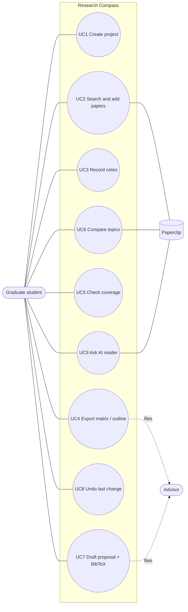
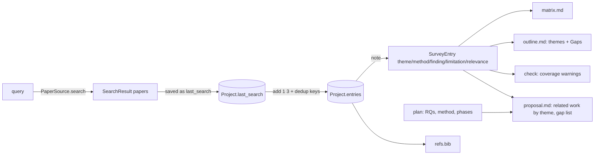
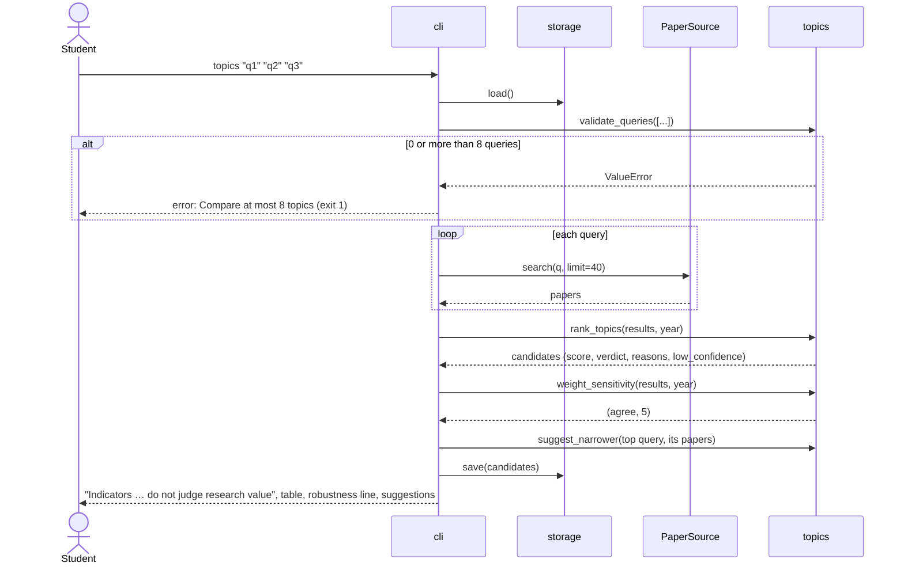
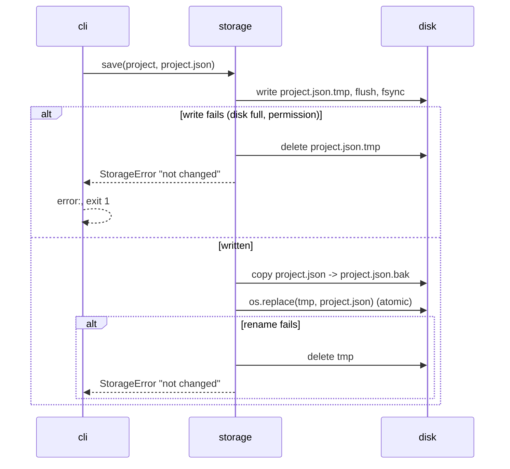
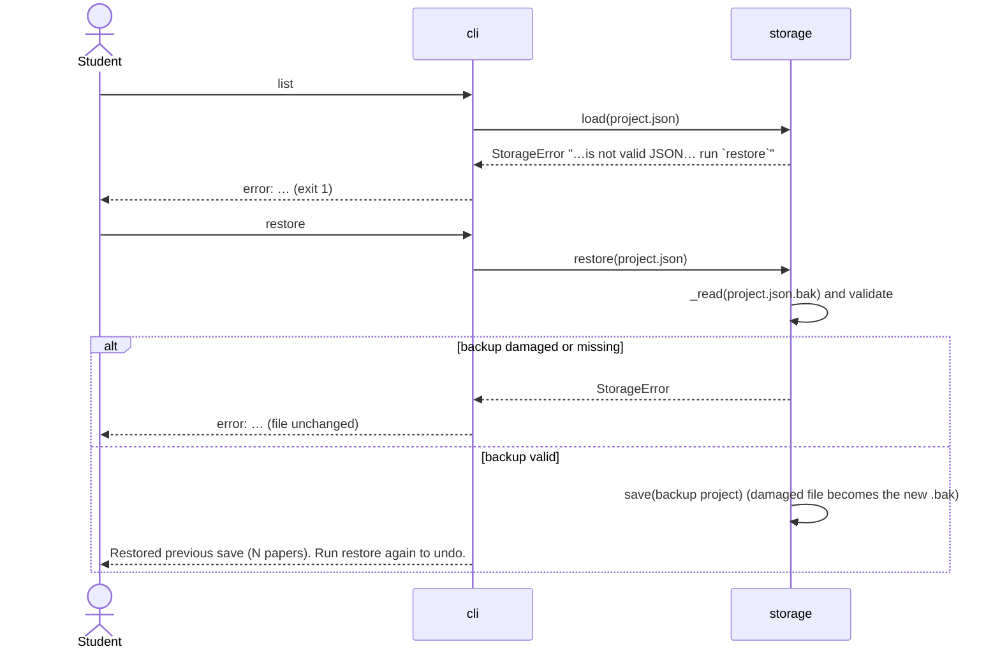
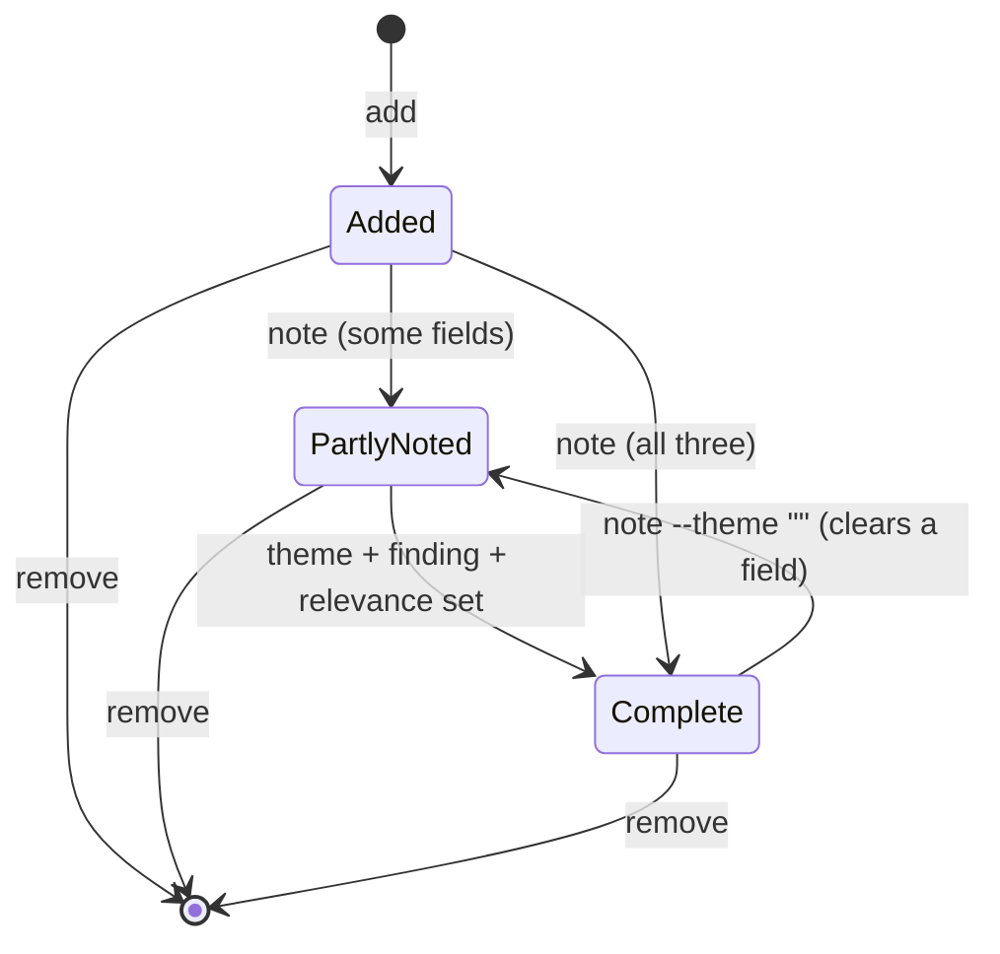
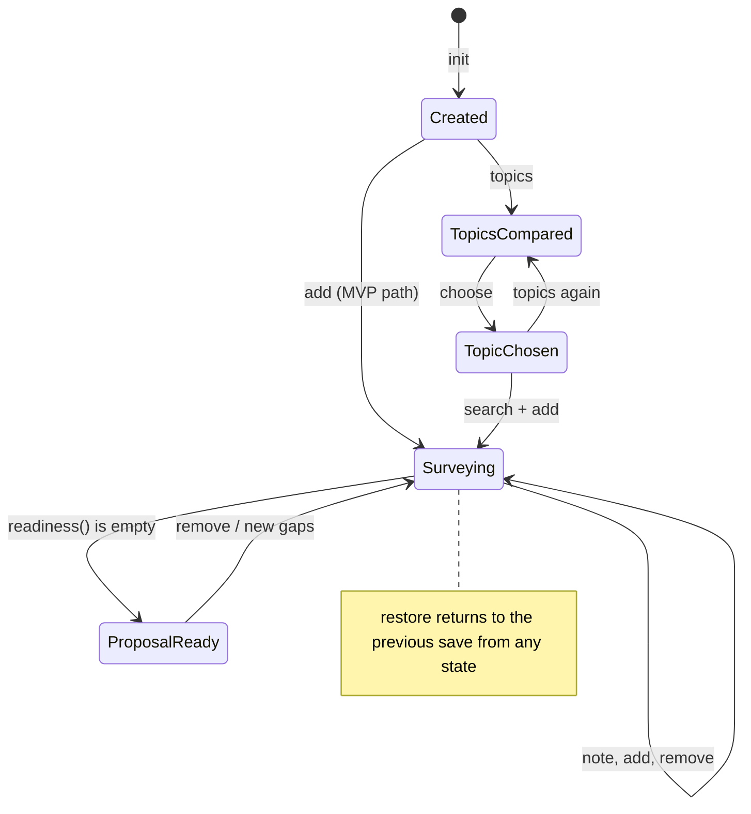

# 02 System Models: Research Compass

Phase 2 deliverable (Sommerville Ch 5). Owner: Dipesh Rayamajhi (Architect). Date: 2026-11-22.

The context model, the search-and-add sequence, and the class model are in [FULL_SPEC.md §3](FULL_SPEC.md).
This file adds the use-case model, three more sequences (including the save and restore failure paths), the
state machines, the information flow from search to proposal, and the requirement-to-model trace.
GitHub renders the Mermaid blocks; each is followed by a plain-text summary.

## 1. Use cases

Summary: one human actor (the student) starts every use case. Paperclip takes part in UC2, UC6 and UC9 only, and
`--offline` replaces it for UC2 and UC6. The advisor never uses the app; they receive exported files.
MVP use cases: UC1–UC4. Increment 2: UC5, UC6. Increment 3: UC7, UC8. Could: UC9.

## 2. Information flow: from a search to a proposal

Summary: a search result is stored only as `last_search` until the student picks numbers with `add`; only then
does it become a `SurveyEntry`. Everything exported is computed from entries and the student's own notes; the app
never invents a finding. The proposal is the only output that combines notes with the `plan` fields.

## 3. Sequence: compare topics (UC6)

Summary: all searches finish before anything is saved, so a Paperclip failure in the second query leaves the file
untouched (R11). Scoring, sensitivity and suggestions are pure functions of the search results and the year.

## 4. Sequence: saving, and what happens when it fails (R26, R27)

Summary: the old file is only ever replaced in one atomic step, after the new content is safely on disk. At every
failure point the student keeps either the old file or the new one, never half of each.

## 5. Sequence: damaged file and restore (R28, R23)

## 6. State machines

Survey entry: `is_complete()` is true only in *Complete*. `check` lists entries not in *Complete* (R13).

Project: the MVP path skips topics entirely (`Created → Surveying`). *ProposalReady* is not stored; it is computed by
`readiness()` each time, so it can never be out of date.

## 7. Requirement → model trace

| Requirement | Model elements |
|---|---|
| R1, R2 | UC1; Project state *Created* |
| R3–R6 | UC2; Full Spec search-and-add sequence; `Project.last_search`, dedup keys in §2 flow |
| R7, R8 | UC3; `SurveyEntry` attributes; entry state machine |
| R9, R10 | UC4; §2 flow (matrix, outline) |
| R11 | every sequence's failure branch |
| R12 | `PaperSource` interface with `OfflineSource` (class model) |
| R13 | UC5; entry state *Complete* |
| R14–R18 | UC6; §3 sequence; `TopicCandidate` incl. `low_confidence` |
| R19–R22 | UC7; §2 flow (proposal, refs.bib); `Phase` |
| R23 | UC8; §5 sequence; note on project state machine |
| R24, R25 | UC9; `PaperclipSource` |
| R26, R27 | §4 sequence |
| R28 | §5 sequence; invariants under the class model |
| R31 | context model (key read-only from login store/env) |
| R32 | failure branch in the search-and-add sequence |

## 8. Inconsistencies found and how they were resolved
1. The v1 project state machine required *TopicChosen* before *Surveying*, but the MVP no longer includes topics. Added the `Created → Surveying` path; `search` takes an explicit query when no topic is chosen (already true in `cli.py`).
2. `restore` (R23) was in no model. Added §5 and a note on the project state machine.
3. `TopicCandidate.low_confidence` was missing from the class model after the R16 change. Added; old files load with the default `false`.
4. The first draft of the entry state machine said a field could only be cleared by hand-editing the JSON. Checking `update_note` showed that `note <id> --theme ""` clears it (only an omitted option is ignored). The diagram now shows that transition. Relevance cannot be cleared back to 0 through the CLI; no requirement asks for that.

**AI contribution:** Claude drew these models from the code after the 2026-11-22 changes. Dipesh to check each
diagram against the running app (Sprint 1 task in the charter).
