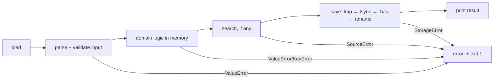

# 03 Architecture: Research Compass

Phase 3 deliverable (Sommerville Ch 6). Owner: Dipesh Rayamajhi (Architect). Date: 2026-11-22.

The pattern choice, component diagram, rejected alternatives, AI-failure handling, and decisions log D1–D7 are in
[FULL_SPEC.md §4](FULL_SPEC.md). This file adds the layer rules, the interfaces between components, how the
architecture supports each likely change, and the trade-offs in Sommerville's terms.

## 1. Layers and the rules between them

| Layer | Modules | May depend on | Must never |
|---|---|---|---|
| Presentation | `cli.py`, `__main__.py` | every module below | contain a business rule (validation, scoring, formatting of exports) |
| Domain logic | `topics.py`, `survey.py`, `proposal.py`, `models.py` | `models.py` and the standard library only | print, read files, read the environment, call the network, import `cli` |
| Data access | `sources.py`, `storage.py` | `models.py`, standard library; `sources.py` alone may import `gxl_paperclip` | contain business rules beyond "is this record valid enough to load" |

Two of these rules are enforced by tests (`test_nonfunctional.py`, R34). The rest are checked in code review
(review checklist item "no logic in `cli.py`").

## 2. Interfaces between components

**PaperSource (data access → presentation).** The only contract the rest of the app has with any paper provider:

```python
class PaperSource(Protocol):
    def search(self, query: str, limit: int = 20, since: str | None = None) -> SearchResult: ...
# SearchResult(papers: list[Paper], result_id: str)
# Raises SourceError(message safe to show the user) on any failure.
```

`PaperclipSource` also offers `ask(question, result_id) -> str`; `OfflineSource.ask` raises `SourceError`.
Paperclip's record fields vary by corpus (`document_id` vs `id`, `pub_date` vs `year`), so `normalize()` accepts
several names and skips records with no id or title rather than failing the whole search.

**Storage (data access → presentation).** `load(path) -> Project`, `save(project, path)`, `restore(path) -> Project`,
all raising `StorageError` with a user-readable message. Storage owns every write to `project.json`; the only other
files the app writes are exports chosen by the student with `-o`, and the `ask` draft.

**Domain functions.** Pure functions over `Project` and `Paper` (signatures in Full Spec §5.1). They raise
`ValueError` or `KeyError` with a message meant for the student; `cli.main` turns those into `error:` + exit 1.

**Error contract (R11).** Every command follows the same shape: load → validate and compute in memory → save once →
print. Because the save is the last step that can fail and it is atomic, any exception before it leaves the file as
it was.



## 3. How the architecture supports the likely changes

| Likely change (Full Spec §7) | What changes | What does not |
|---|---|---|
| Editable score weights | `models.py` + `storage.py` (new field, schema v2 migration), `cli.py` (new command) | `topics.py` — it already takes `weights` |
| Second paper source (OpenAlex, Semantic Scholar) | one new class in `sources.py`, a `--source` flag in `cli.py` | domain logic, storage, every test that uses `OfflineSource` |
| Web front end (if usability test fails) | a new presentation module (e.g. Flask) calling the same functions | all domain and data-access modules |
| Department proposal template | `proposal.build_proposal` | everything else |

## 4. Trade-offs (Sommerville Ch 6 quality attributes)

| Attribute | How the architecture serves it | What we gave up |
|---|---|---|
| Maintainability | small modules with one job each; layers; adapter isolates the SDK | a little indirection (`PaperSource`) for a two-implementation interface |
| Testability | domain logic is pure; sources are swappable; storage is one module | none significant |
| Availability | offline mode; Paperclip failures become hints | live search still needs the service; no caching of results across sessions beyond `last_search` |
| Safety of user data | atomic save, backup, validation in one place | one-step undo only; not a database with transactions |
| Performance | in-memory processing of a small JSON file (20 ms for 200 papers) | would need a different store beyond a few thousand papers — far past a thesis survey |
| Usability | plain-text output, one-line errors with the next step | a terminal is still a barrier; measured by R30 |
| Security / privacy | key never handled by our code beyond the SDK's own lookup; local storage | queries and AI questions go to a third party; documented in the README |

## 5. Architecture review checklist (used in PR review)
- [ ] Does the change add logic to `cli.py`? Move it down a layer.
- [ ] Does a domain module now read a file, the clock, or the environment? Pass the value in instead (as `now_year` is).
- [ ] Is a new external library or service reached only through an adapter in the data-access layer?
- [ ] Does the command still follow load → validate → compute → save once → print?
- [ ] Is a new decision written in the decisions log with its R-number?

**AI contribution:** Claude wrote the layer rules, interfaces section and trade-off table from the code. Dipesh to
confirm the trade-offs are ones the team would argue for in the presentation (beat 4).
