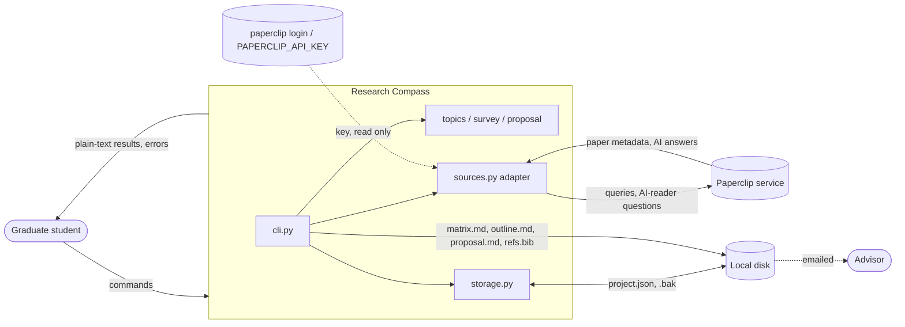
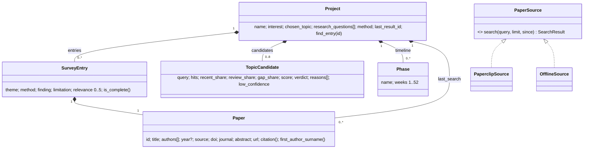
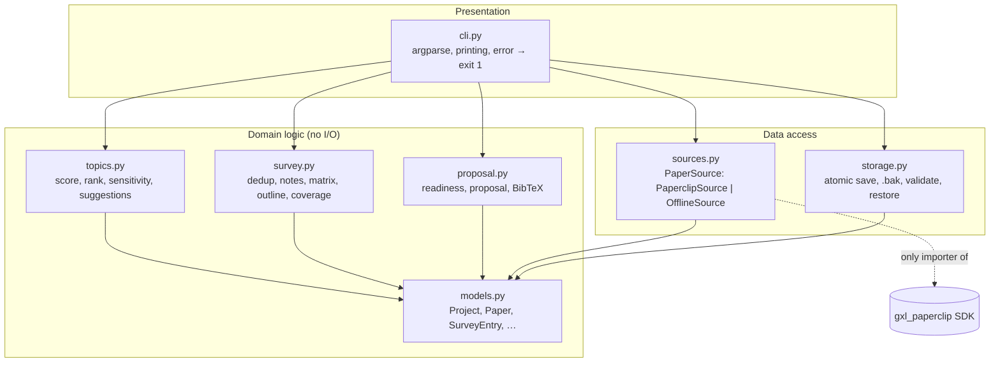

# Full Spec: Research Compass

**Team:** Research Compass (Haoxuan Zhang, Dipesh Rayamajhi, Sulav Ghimire, Aayush Byanjankar)  **Date:** 2026-11-22  **Committer:** Haoxuan Zhang

**Roles:** Product Owner Haoxuan Zhang | Process lead Aayush Byanjankar (Sprint 1; rotates, see [charter](00_team_charter.md#roles)) | Architect Dipesh Rayamajhi | Quality lead Sulav Ghimire | Prompt engineer Aayush Byanjankar

> Roles and tasks were assigned automatically on 2026-11-22 from the team list (four people, five roles, so
> Aayush holds two). Confirm or swap them at the first stand-up. Each section's owner must be able to explain
> it without the AI. Gaps we know about are marked `TODO:`. Per-sprint tasks: [00_team_charter.md](00_team_charter.md#tasks).

Related files: [RUN_BRIEF.md](RUN_BRIEF.md) (what se-agent reads, 3,823 characters) ·
[00_team_charter.md](00_team_charter.md) · [01_requirements.md](01_requirements.md) ·
[02_models.md](02_models.md) · [03_architecture.md](03_architecture.md) ·
[05_test_plan.md](05_test_plan.md) · [06_evolution_and_retro.md](06_evolution_and_retro.md) ·
[workbook.md](workbook.md)

---

## Changes since the Project Brief (response to the 92/100 evaluation)

| Feedback | What we changed | Where |
|---|---|---|
| A. Ten Must-dos is too much scope; several bundle many behaviours | The **MVP is the literature-survey core only** (10 brief Must-dos → 12 single-behaviour functional requirements R1–R12). Topic indicators move to Increment 2 and the proposal skeleton to Increment 3, both as Should. The "generate proposal" item was split into four requirements (R19–R22). | §2, [RUN_BRIEF.md](RUN_BRIEF.md) |
| B. Scoring methodology not justified | Documented the formula, the purpose of each indicator, how the weights were chosen, and what each one cannot tell you (§5.3). **Code changes:** papers missing a year or abstract are now left out of that share instead of counting as "no", over half missing → "low confidence" (R16); every comparison now reports whether the top topic stays first under 5 alternative weightings (R17); the output says the numbers are indicators, not a judgement of research value. Planned validation against advisor rankings (§6). | §5.3, `topics.py`, `test_topics.py` |
| C. Architecture needs a context diagram, component diagram, data model, and justification | Added all three plus sequence and state models, a decisions log tied to R-numbers, and the trade-offs (§3, §4). | §3, §4, [02_models.md](02_models.md), [03_architecture.md](03_architecture.md) |
| D. Is a terminal usable by non-programmers? | Wrote a realistic user scenario and a usability test with 2 graduate students from outside the team, with pass thresholds and a decision rule for adding a web front end (§2 R30, §6). | §2, §6 |
| E. Reliability and data integrity under failure | **Code changes:** saves now flush to disk before the atomic rename, clean up the temp file on failure, and keep the previous version as `project.json.bak`; a new `restore` command undoes the last save; loading rejects duplicate papers, relevance outside 0–5, zero-week phases, and non-object files, and points the user to `restore`. Write errors (e.g. `-o` into a missing folder) now give `error:` + exit 1 instead of a traceback. | R26–R28, `storage.py`, `test_storage.py` |
| F. Brief over the 4,000-character limit | The v2 brief is **3,823 characters**. (By our count the v1 brief was 3,978, just under the limit; we still cut it so detail lives here instead.) | [RUN_BRIEF.md](RUN_BRIEF.md) |
| Quality expectations lacked code review | The brief now requires a PR reviewed by another member with green tests and a test seen to fail. | §1, §5 |
| Open questions had no owners | Every open question now names an owner role and how it will be answered. | §2, §8 |
| (Found while preparing this spec) | The repo's tests had been uploaded inside the package folder and `.gitignore` had become a file named `download`, so `pytest` failed to collect. `uv sync` also failed because the optional Paperclip dependency pointed to an unversioned wheel. All three are fixed; CI now runs the tests on Python 3.10 and 3.12. | `app/tests/`, `app/pyproject.toml`, `.github/workflows/tests.yml` |

---

## 0. The idea (Chapter 1)
- **The single main problem, and for whom:** a graduate student starting a thesis loses weeks keeping track of which papers they found, what each one said, and where the gaps are, so they need one place that turns searches and reading notes into an organized literature survey.
- **Who is harmed if this app fails, is wrong, or leaks data?**
  - The **student**, if months of reading notes are lost or corrupted (the biggest harm; hence R11, R26–R28), or if they pick a topic because a heuristic score looked authoritative (hence R16, R17 and the "indicators, not a judgement" wording).
  - The **advisor and committee**, if a citation or summary is wrong; the app only formats the student's own notes and labels AI text as unverified (R24).
  - The **student's unpublished ideas**: queries and AI-reader questions go to Paperclip, so the student must know that (R31).
- **Anything the app must never do:**
  - Never store the Paperclip API key in the project file, exports, or the repo (R31).
  - Never change the project file when a command fails (R11).
  - Never write AI-generated text into the student's notes or proposal on its own (R24).
  - Never present fictional demo papers as real: every demo id starts with `demo_` and the source reads "demo (fictional)" (R12).

## 1. Process and plan (Chapters 2 and 3)  Owner: Process lead Aayush Byanjankar
- **Process model and why it fits:** incremental, Scrum-lite agile with three one-week sprints. The core (survey bookkeeping) is well understood and can ship first, while the riskiest questions — do the topic indicators help, can non-programmers use a terminal — can only be answered by putting working increments in front of users, which a plan-driven process would delay to the end.
- **Plan-driven parts we keep:** the brief, this Full Spec, and the decisions log, because the course grades them and se-agent reads the brief.
- **Practices we actually use:** sprint planning from a GitHub Projects board (Backlog / Sprint / Doing / Review / Done); 3-line stand-up (done / next / blocked) in class and in the sprint Issue on other days; pull-request review by one other member; tests on every push (GitHub Actions); sprint review demo and a retrospective with one improvement per sprint.
- **Definition of Done:**
  - [ ] Merged through a pull request approved by someone other than the author
  - [ ] `cd app && uv run pytest` is green locally and in CI
  - [ ] The change has a new or updated test, and the author saw that test **fail** with the feature broken (noted in the PR)
  - [ ] The requirement and test rows in [05_test_plan.md](05_test_plan.md) are updated
  - [ ] README updated if a command, flag, or message changed
  - [ ] No keys, tokens, or personal data in the diff
  - [ ] AI-drafted parts are named in the PR description
- **Sprint plan** (the instructor sets the real dates):

| Sprint | Working software at the end | se-agent run? |
|---|---|---|
| 1 — MVP | R1–R12 and R26–R34 hardened and demoable offline: `init`, `search`, `add` (with dedup), `note`, `list`, `matrix`, `outline`, error contract, backups. CI green. | Run 1: prompts 01–03 on the v2 brief, to check that our requirements and architecture match what an independent reading of the brief produces |
| 2 — Topic indicators | R13–R18: `check`, `topics` with missing-data handling and the weight-sensitivity line, narrower suggestions. Usability test 1 (2 students). Advisor ranking of demo topics. | Run 2: prompt 05 (tester), to find requirements our tests miss |
| 3 — Proposal skeleton | R19–R23: `plan`, `proposal`, `bib`, `restore`. Change request carried out (§7). Final demo. | Run 3 (only if Run 2 was useful): prompt 06 (evolution planner) on the change request |

- **Biggest schedule risk and what we will do about it:** the existing prototype already implements most features (it was drafted quickly with AI before the brief was graded), so the risk is spending the sprints on new features instead of proving the MVP works. Mitigation: features beyond the current sprint are frozen; a sprint is "done" only when its requirements meet the Definition of Done, including the "test seen to fail" check. If Sprint 2 runs late, R17–R18 are dropped first, then R16's low-confidence flag.
- **AI contribution:** Claude proposed the three-increment split and the Definition of Done items. The team must confirm the sprint dates and that the frozen-feature rule is acceptable. TODO: team review.

## 2. Requirements (Chapter 4)  Owner (Product Owner): Haoxuan Zhang

**Stakeholders and what each wants:**

| Stakeholder | Wants |
|---|---|
| Graduate student (primary user) | Less bookkeeping while reading; a survey and outline they can hand to an advisor; never losing notes; a quick, honest sense of whether a topic is crowded |
| Advisor / committee | Evidence the survey is broad and current; correct citations; to know which text the student wrote and which an AI drafted |
| Course instructor (customer) | A small, testable product; traceable SE process; controlled AI cost |
| Paperclip (external service) | Use within its authentication and rate limits |
| Team | A scope it can finish and defend in three sprints |

**User scenario (for usability and the system test).** Lin is a first-year MPH student, comfortable with Word and Zotero, who has never used a terminal beyond copying a command. Their advisor asked for "a table of the 15 most relevant papers on federated learning in medical imaging, with what each found and what is still open" by next week. Lin opens Terminal, follows the README, and runs `init`, then `search "federated learning medical imaging"`, reads the numbered list, and adds five papers with `add 1 2 4 7 9`. Over the next days Lin reads each paper and runs `note demo_002 --theme "client drift" --finding "..." --limitation "..." --relevance 5`. Accidentally adding the same paper again prints "skipped 1 duplicate". Typing `--relevance 7` prints an error and changes nothing. Before the meeting Lin runs `check` (which warns that only 5 papers have notes), adds more, then `matrix -o matrix.md` and `outline -o outline.md`, and emails both files. If Lin damages `project.json` by editing it in a text editor, the next command explains the problem and `restore` brings back the previous save.

**User stories** (each with acceptance criteria; full Given/When/Then in [01_requirements.md](01_requirements.md)):
1. *As a graduate student, I want to search for papers and add the ones I choose to my survey, so that all my sources are in one place.* — `search` shows numbered results; `add 1 3` adds exactly those two; `add 99` after 20 results is rejected and nothing changes; a paper already in the survey is skipped and reported. (R3–R6)
2. *As a graduate student, I want to record a theme, method, key finding, limitation, and relevance for each paper, so that I do not have to re-read papers when writing.* — `note` stores each field; relevance 0, 6, and −1 are rejected; an unknown paper id is rejected; the file is unchanged after any rejection. (R7, R8, R11)
3. *As a graduate student, I want to export a literature matrix and an outline grouped by theme, so that I can show my advisor the state of the field.* — matrix has one row per paper and survives `|` in notes; outline lists themes largest first and ends with a Gaps section. (R9, R10)
4. *As a graduate student, I want my notes to survive mistakes and crashes, so that months of reading are never lost.* — a failed save leaves the file unchanged; each save keeps the previous version; `restore` undoes the last save; a damaged file produces a clear message and a way back. (R11, R23, R26–R28)
5. *As a graduate student choosing between topics, I want to see how active, open, and review-heavy each candidate's literature is, so that I can discuss the choice with my advisor using evidence.* — each topic shows a 0–100 score, a verdict, and the 4 indicators; "too narrow" under 5 papers; "saturated" at 40% review titles; missing data and weight sensitivity are reported. (R14–R17)
6. *As a graduate student, I want a proposal skeleton built from my notes, so that I start writing from structure, not a blank page.* — sections in order, author-year citations, timeline with cumulative weeks, references, and visible `_TODO_` markers for anything missing. (R19–R22)
7. *As a student without Paperclip access, I want to try every feature with sample data, so that I can learn the tool before signing up.* — `--offline` runs every command but `ask` with no network. (R12)

**Requirements table.** Priority: **Must** = MVP, Increment 1; **Should** = Increments 2–3 in the order of the brief's Should list; **Could** = only if time remains. One behaviour per row.

| ID | Type | Requirement (one testable sentence) | Priority | Acceptance test (input → expected result) |
|---|---|---|---|---|
| R1 | F | `init <name> --interest <text>` shall create a project JSON file holding the name and interest. | Must (Inc 1) | `init thesis --interest "x"` → file exists; loading it gives name "thesis", interest "x" |
| R2 | F | `init` shall refuse to overwrite an existing project file unless `--force` is given. | Must (Inc 1) | second `init t` → `error:`, exit 1, file byte-identical |
| R3 | F | `search <query>` shall list results numbered from 1 with title, author-year citation, id, and source, marking papers already in the survey with `*`. | Must (Inc 1) | offline search, `add 2`, search again → line 1 starts `   1. `, result 2 starts `*  2. ` |
| R4 | F | `add` shall add the listed result numbers (comma- or space-separated) or `all` from the last search. | Must (Inc 1) | `add 1,2 3` → survey has those 3 papers |
| R5 | F | `add` shall reject a number outside 1..N, a non-number, or use before any search, leaving the survey unchanged. | Must (Inc 1) | 20 results, `add 99` → `error: '99' is not a result number between 1 and 20`, survey empty |
| R6 | F | Adding a paper whose id, DOI (case-insensitive), or normalized title matches a surveyed paper shall skip it and print the number skipped. | Must (Inc 1) | `add 1` twice → "skipped 1 duplicate"; same title with different id and no DOI → skipped |
| R7 | F | `note <id>` shall set any of theme, method, finding, limitation (whitespace collapsed, theme lower-cased) and leave unspecified fields unchanged; an unknown id is rejected. | Must (Inc 1) | `--theme "  Privacy  "` → theme "privacy"; `note missing --theme x` → error, file unchanged |
| R8 | F | Relevance shall accept only integers 1–5; any other value is rejected and the stored relevance is unchanged. | Must (Inc 1) | relevance 0, 6, −1 → error; previous value kept; 1 and 5 accepted |
| R9 | F | `matrix` shall output a Markdown table with one row per surveyed paper and columns Ref, Title, Theme, Method, Key finding, Limitation, Relevance, escaping `\|` in text. | Must (Inc 1) | finding "a \| b" → row still has 7 cells |
| R10 | F | `outline` shall group papers by theme (largest first, "unsorted" last), list each with its citation and finding, and end with a "Gaps reported in the literature" section listing every recorded limitation. | Must (Inc 1) | 2 "privacy" + 1 unsorted paper → section 1 Privacy (2), section 2 Unsorted, then Gaps |
| R11 | F | Every handled error shall print one `error:` line on stderr, return exit code 1, and leave the project file byte-identical. | Must (Inc 1) | bad `add`, `note`, `plan`, `init` → each exit 1, file bytes unchanged |
| R12 | F | `--offline` shall use the bundled fictional papers (ids `demo_…`, source "demo (fictional)") so every command except `ask` works with no network or account. | Must (Inc 1) | full workflow test passes with networking unavailable |
| R13 | F | `check` shall warn about: fewer than 10 papers, papers missing theme/finding/relevance, themes with one paper, no paper from the last 3 years, no recorded limitation (and proposal readiness gaps). | Should (Inc 2) | 1 old unnoted paper → all five warnings; complete 10-paper survey → none |
| R14 | F | `topics` shall compare 1–8 distinct queries and show for each a score 0–100, a verdict, and 4 indicator lines (papers found, % recent, % with gap phrases, % review titles); 0 or more than 8 is rejected. | Should (Inc 2) | 9 queries → error; 3 demo topics → 3 ranked rows with 4 reasons each |
| R15 | F | Verdicts: fewer than 5 papers → "too narrow" (ranked last); ≥ 40% review titles → "saturated"; otherwise score ≥ 60 "promising", ≥ 40 "possible", else "weak". | Should (Inc 2) | 3 papers → too narrow, ranked below a 10-paper weak topic; 10 survey titles → saturated |
| R16 | F | Papers without a year (or abstract) shall be left out of the recency (or gap) share; the count missing shall be shown; if over half lack either, the topic is marked "low confidence". | Should (Inc 2) | 5 gap abstracts + 5 empty → gap share 100% and "5 have no abstract"; 6 of 10 undated → low confidence; 5 of 10 → not |
| R17 | F | `topics` shall report how many of 5 alternative weightings (equal weights; each indicator dropped in turn) keep the same topic first. | Should (Inc 2) | topic winning only on recency → "4 of 5"; dominant topic → "5 of 5" |
| R18 | F | `topics` shall suggest up to 5 narrower wordings for the top topic from two-word title phrases that occur in at least 2 papers and share no word with the query. | Should (Inc 2) | titles "Client drift in…", "Correcting client drift…" → "federated client drift" |
| R19 | F | `proposal` shall output sections 1–7 and References, with related work grouped by theme and author-year citations. | Should (Inc 3) | noted project → "## 2. Background", "(Garcia, 2025)", "## References" present |
| R20 | F | Any missing proposal part shall appear as a visible `_TODO: …_` marker, and readiness problems shall be printed as warnings on stderr. | Should (Inc 3) | empty project → TODO for topic, RQs, method, timeline |
| R21 | F | `plan --phase "Name:weeks"` shall accept 1–52 whole weeks, and the proposal timeline shall show each phase's end week and the total. | Should (Inc 3) | phases 4, 8, 4 → "Ends week" 4, 12, 16 and "Total: 16 weeks."; `Review:0` → error |
| R22 | F | `bib` shall output one BibTeX entry per surveyed paper with unique keys. | Should (Inc 3) | 3 papers same author/year/word → keys `…`, `…b`, `…c` |
| R23 | F | `restore` shall swap the project file with its `.bak`, so running it twice returns to the original, and refuse a damaged backup. | Should (Inc 3) | add 1 paper, `restore` → 0 papers; damaged `.bak` → error, file unchanged |
| R24 | F | `ask <question>` shall run Paperclip's AI reader over the last search and save the answer to a new file headed "AI DRAFT (unverified)", never changing the notes. | Could | fake client → file starts with the header; `--offline` → error naming `note` as the alternative |
| R25 | F | `--corpus <name>` shall restrict live searches to one Paperclip source. | Could | fake client receives `source="arxiv"` |
| R26 | NF (reliability) | A save shall write a temp file, flush it to disk, then atomically rename it; if any step fails the project file is unchanged and no `.tmp` file remains. | Must (Inc 1) | `os.replace` forced to fail → StorageError "not changed", bytes unchanged, no `.tmp` |
| R27 | NF (reliability) | Every save shall keep the previous version of the project file as `<file>.bak`. | Must (Inc 1) | save twice → `.bak` equals the first version |
| R28 | NF (data integrity) | Loading shall reject invalid JSON, a non-object file, an unknown schema version, duplicate paper ids, relevance outside 0–5, and phases under 1 week, with a message naming the problem and pointing to `restore` when a backup exists; never a traceback. | Must (Inc 1) | each damaged file → StorageError with the problem named; with a `.bak` present the message contains "restore" |
| R29 | NF (performance) | With 200 surveyed papers, save + load + every export + comparing 8 topics shall take under 2 s in total; the full test suite under 10 s. | Must (Inc 1) | `test_200_paper_project_is_fast` (measured 20 ms on an M-series laptop); suite ≈ 0.2 s |
| R30 | NF (usability / accessibility) | Output shall be plain text with no colour-only meaning; every error message shall state what to do next; in a usability test, at least 2 graduate students from outside the team shall complete the 6 core tasks of the user scenario in ≤ 30 minutes with ≤ 2 hints each. | Must (Inc 1 text rules; Inc 2 test) | review checklist; usability test results recorded in [05_test_plan.md](05_test_plan.md) |
| R31 | NF (security / privacy) | The Paperclip key shall come only from `paperclip login` or `PAPERCLIP_API_KEY` and never be written to the project file, exports, or repo; only search queries and `ask` questions leave the computer. | Must (Inc 1) | key set in env, full offline workflow → key string absent from every file written |
| R32 | NF (availability) | Paperclip problems (SDK missing, not signed in, auth expired, rate limit, timeout, network, server error) shall each give a one-line hint and exit 1, with no traceback. | Must (Inc 1) | SDK import blocked → "pip install … --offline"; `from_env` fails → "paperclip login" |
| R33 | NF (cost) | The app shall make no paid model calls of its own; the test suite shall cost $0 and need no network or account. | Must (Inc 1) | tests use `OfflineSource` and a fake client only; CI has no secrets |
| R34 | NF (maintainability) | Logic modules shall not import `cli`; only `sources.py` shall import the Paperclip SDK; `uv run pytest` shall run all tests. | Must (Inc 1) | AST-based tests in `test_nonfunctional.py` |
| R35 | NF (portability) | The app shall run on Python 3.10+ on Windows, macOS, and Linux with no compiled dependencies. | Should | CI matrix Python 3.10 and 3.12 (Linux); TODO: one manual run on Windows |

Counts: 25 functional (12 Must, 11 Should, 2 Could) and 10 non-functional (9 Must, 1 Should). Old workbook IDs map to these in [01_requirements.md](01_requirements.md#id-map).

**Out of scope** (so nobody builds it by accident):
- Web or mobile interface (see §7 for how we would add one later)
- Accounts, multi-user sharing, cloud sync
- PDF download or full-text reading (Paperclip already reads full text server-side)
- Finished proposal prose; citation styles other than author-year; department templates
- Plagiarism checks
- Editable score weights (documented as the most likely change, §7)

**Requirements we removed as unnecessary, and why:**
- *"Score as a judgement of topic quality"*: replaced by "indicators plus sensitivity", because a heuristic over search metadata cannot establish that a topic is promising (evaluation point B).
- *Proposal generation as one Must*: split into R19–R22 and moved to Increment 3, because it bundled five behaviours and depends on the survey being finished first.
- *Narrower-topic suggestions as a Must*: now Should R18; useful but not needed to organize a survey.
- *Web UI* (cost doubles; no evidence yet that users need it — the usability test decides).

**Open questions** (owner → how it will be resolved → what it changes):
- Do the indicators agree with how advisors judge topics? → Product Owner → 2 advisors rank the 3 demo topics plus 2 of their own; we compare with the app's ranking (§6) → if they disagree, we change the wording of verdicts first and the weights second.
- Is Paperclip's coverage (arXiv, PMC, bioRxiv, medRxiv) enough for students outside biomedicine and CS? → Architect → run 5 queries from a social-science and an education student → if coverage is poor, a second `PaperSource` (e.g. OpenAlex) becomes the top evolution item.
- Can non-programmers use the terminal? → Quality lead → usability test, R30 → if fewer than 2 of 2 pass, a thin web front end becomes a Sprint-4 candidate.
- Must the proposal follow a department template? → Product Owner → ask the DTSC graduate coordinator → only changes R19's section list.
- What counts as "recent" in slow-moving fields? → Product Owner → advisor interviews → only changes the `RECENT_YEARS` constant.

**Check:** we removed "promising/saturated" as claims about research value; the remaining unmeasured words are none ("fast" became R29's 2 s, "usable" became R30's task test, "secure" became R31's file check).
- **AI contribution:** Claude split the brief's 10 Must-dos into single behaviours, proposed the MVP boundary, the user scenario, and the NF numbers (2 s, 30 minutes, 2 hints). The 2 s limit was checked by measurement (20 ms). TODO: Haoxuan Zhang must confirm the MVP boundary with the instructor and the usability thresholds with the team.

## 3. Models (Chapter 5)  Owner (Architect): Dipesh Rayamajhi
Full set with more sequences: [02_models.md](02_models.md).

**Context model.** Inside the system: the command-line interface, the domain logic (topics, survey, proposal), the paper-source adapter, and JSON storage. Outside: the student, the Paperclip service, the local file system, and the advisor who reads exported files. Crossing the boundary: commands in, text out; queries and AI-reader questions out to Paperclip, paper metadata and AI answers back; the project file and exports to disk. The API key is read from Paperclip's own login store or the environment and never stored by us.



**Sequence model for the most important story (US1: search and add), including the failure path:**

```mermaid
sequenceDiagram
  actor S as Student
  participant C as cli
  participant St as storage
  participant Src as PaperSource
  participant Sv as survey
  S->>C: search "federated learning"
  C->>St: load(project.json)
  C->>Src: search(query, limit)
  alt Paperclip unavailable / not signed in
    Src-->>C: SourceError("Run paperclip login ... or --offline")
    C-->>S: error: ..., exit 1 (file untouched)
  else results
    Src-->>C: SearchResult(papers, result_id)
    C->>St: save(project with last_search)
    C-->>S: numbered list, * = already surveyed
  end
  S->>C: add 1 3 99
  C->>St: load(project.json)
  C->>C: parse picks
  C-->>S: error: '99' is not a result number between 1 and 20 (exit 1, no save)
  S->>C: add 1 3
  C->>Sv: add_papers(project, [p1, p3])
  Sv-->>C: (added 1, skipped 1)
  C->>St: save (tmp → fsync → .bak → rename)
  C-->>S: Added 1 paper(s); skipped 1 duplicate(s)
```

**Class / data model** (the JSON file mirrors it, plus `schema_version: 1`):



Invariants enforced on load (R28): paper ids in `entries` are unique; relevance is 0 (unrated) or 1–5; phase weeks ≥ 1.

**State model.** A survey entry: *added* → *partly noted* → *complete* (theme, finding, and relevance all set) — `is_complete()`. The project: *created* → *topics compared* → *topic chosen* → *surveying* → *proposal ready* (`readiness()` returns nothing). Every state can return to an earlier one (re-choose, remove a paper), and `restore` returns the whole project to the previous save. The app has no modes beyond `--offline` vs live, which is chosen per command, not stored.

**Consistency check:**
- R23 (`restore`) appeared in no model at first; added to the state model as "previous save".
- The class model showed `ask()` on `PaperSource`, but only Paperclip supports it; the interface stays search-only and `OfflineSource.ask()` raises a clear `SourceError` (R24).
- `TopicCandidate.low_confidence` (new for R16) was added to the class model and the JSON; older files without it load with the default `false`, so no schema bump was needed.
- `last_search` exists only so `add` can refer to result numbers; no requirement needs it exported, so it is not in the matrix or outline.
- **AI contribution:** Claude drew all diagrams from the code; the team must check each against the running app. TODO: Dipesh Rayamajhi to review.

## 4. Architecture (Chapter 6)  Owner (Architect): Dipesh Rayamajhi
Component responsibilities and interfaces in detail: [03_architecture.md](03_architecture.md).

- **Pattern:** a **layered architecture** — presentation (`cli.py`) → domain logic (`topics.py`, `survey.py`, `proposal.py`, `models.py`) → data access (`sources.py`, `storage.py`) — with an **Adapter** around the Paperclip SDK and **Strategy** to swap the live and offline sources.
- **Non-functional requirements that drove it:** R34 (maintainability: logic has no I/O, so it is unit-tested directly), R12/R33 (offline mode and $0 tests need a swappable source), R32 (one place converts SDK errors into hints), R11/R26–R28 (one module owns every file write, so the error and atomic-save rules are enforced once).

**Component diagram:**



Allowed dependencies: down the layers only. Domain modules never import `cli`, `sources`, or `storage`; this is checked by a test (R34).

- **Alternatives we rejected, and why:**
  - *Web app (Flask/Streamlit):* roughly doubles the code and adds a server to run, before we know users need it (R30's usability test decides). The layering means a web front end would replace only `cli.py`.
  - *Calling the Paperclip CLI through `subprocess`:* fragile text parsing; the SDK returns structured records and typed errors (R32).
  - *SQLite:* one JSON file is enough for hundreds of papers (R29: 149 KB and 20 ms for 200), can be read by a person, and diffs in git. SQLite would give transactions, but atomic rename plus `.bak` gives the protection we need (R26–R27).
  - *Ranking topics with an LLM:* not explainable, not reproducible, and costs money (R33); the indicators can be checked by hand.
- **AI in the app:** only the optional `ask` command (Could, R24), which runs Paperclip's `map` reader on Paperclip's servers.
  - *Slow:* 300 s timeout, then "Paperclip took too long. Try a smaller --limit."
  - *Wrong:* the answer is saved to a separate file headed "AI DRAFT (unverified)" and never merged into notes; the student copies checked points with `note`.
  - *Down / offline:* a one-line error naming `note` as the manual alternative; every other feature works.
  - *Cost per use:* the app pays nothing; `map` usage counts against the student's Paperclip plan. TODO: Dipesh Rayamajhi to record Paperclip's current plan limits before the demo.

**Decisions log**

| # | Decision | Alternatives | Reason (tie to an R-number) | Consequence |
|---|---|---|---|---|
| D1 | Layered CLI app | Web UI; Jupyter notebook | R34 testable core; smallest working slice for the MVP | Less approachable for non-programmers → measured by R30 |
| D2 | Paperclip SDK behind a `PaperSource` adapter; `OfflineSource` as a second strategy | Subprocess to CLI; raw HTTP | R12, R32, R33: fakeable, typed errors, offline | We depend on SDK field names; `normalize()` accepts several variants and skips bad records |
| D3 | Explainable indicators with printed reasons, missing-data handling, and a weight-sensitivity line | Single opaque score; LLM judgement | R14–R17; feedback B: the student must be able to check every number | Gap detection is English phrase matching and misses gaps worded differently (documented in §5.3) |
| D4 | One JSON file, atomic save (temp + fsync + rename), `.bak` of the previous version, validation on load | SQLite; YAML; no backup | R26–R28: crash-safe, recoverable, human-readable | One-step undo only; a schema change needs a migration function |
| D5 | Fictional bundled demo corpus | A sample of real papers | R12: no licensing or fake-citation risk; deterministic tests | Demo results look plausible but are not real; ids and source say so |
| D6 | AI reader output goes to a separate draft file | Auto-fill notes | §0 "never": a human stays between AI text and the proposal | The student copies verified points by hand |
| D7 | MVP = survey core; topics and proposal are later increments | Build all features at once | Feedback A; Sprint risk §1 | The demo of topic scoring waits for Sprint 2 |

- **AI contribution:** Claude proposed D7 and the component diagram and wrote the rejected-alternative reasons; D1–D6 come from the team's earlier workbook. TODO: Dipesh Rayamajhi to confirm every reason is one the team agrees with.

## 5. Design and implementation (Chapter 7)  Owner: Dipesh Rayamajhi (Architect)

### 5.1 Modules and owners

| Module | Owner | Responsibility | Main interface |
|---|---|---|---|
| `cli.py` | Aayush Byanjankar | Parse arguments, call logic, print results; turn `ValueError`, `KeyError`, `OSError`, `SourceError`, `StorageError` into `error:` + exit 1 | `main(argv, now) -> int`; one `cmd_*` per sub-command |
| `models.py` | shared (Dipesh Rayamajhi approves changes) | Data classes and citation formatting | `Paper.citation()`, `SurveyEntry.is_complete()`, `Project.find_entry(id)` |
| `survey.py` | Haoxuan Zhang | Dedup, notes, matrix, outline, coverage | `add_papers(project, papers) -> (added, skipped)`, `update_note(...)`, `literature_matrix(project) -> str`, `outline(project) -> str`, `coverage_report(project, now_year) -> list[str]` |
| `topics.py` | Sulav Ghimire | Indicators, verdicts, ranking, sensitivity, narrower suggestions | `score_topic(query, papers, now_year, weights) -> TopicCandidate`, `rank_topics(...)`, `weight_sensitivity(results, now_year) -> (agree, total)`, `suggest_narrower(...)` |
| `proposal.py` | Aayush Byanjankar | Readiness, proposal skeleton, BibTeX | `readiness(project) -> list[str]`, `build_proposal(project) -> str`, `to_bibtex(papers) -> str`, `parse_phase(text) -> Phase` |
| `sources.py` | Dipesh Rayamajhi | Adapter to Paperclip; offline source; friendly errors | `PaperSource.search(query, limit, since) -> SearchResult`; `ask(question, result_id) -> str` |
| `storage.py` | Dipesh Rayamajhi | JSON save/load, backup, validation, restore | `save(project, path)`, `load(path) -> Project`, `restore(path) -> Project`, `backup_path(path)` |

### 5.2 Where the logic lives apart from the display
All rules (dedup keys, relevance range, scoring, verdicts, timeline arithmetic, validation) live in `survey.py`, `topics.py`, `proposal.py`, and `storage.py`, which return values or raise exceptions and never print. `cli.py` only parses and prints. This is why 90%+ of lines are covered by fast unit tests, and why a future web front end would replace only `cli.py`.

### 5.3 Scoring method and its limits (feedback B)
The topic score is an **indicator of what the search results look like**, not a measure of research value. The output says so on its first line.

`score = 100 × (0.35·recent + 0.30·gap + 0.20·volume + 0.15·unsaturated)`

| Indicator | Computed as | Why it is there | What it cannot tell you |
|---|---|---|---|
| recent | share of **dated** papers from this year or last year | an active field publishes now | fast fields look "hot" by default; slow fields (e.g. ecology) look stale |
| gap | share of papers **with an abstract** whose abstract contains a phrase like "remains unclear", "future work", "limitation" | authors state open problems in abstracts | phrase matching misses other wordings and counts boilerplate "limitations" |
| volume | min(papers, 40) / 40 | a thesis survey needs enough literature | the search limit caps hits, so this only separates "few" from "enough" |
| unsaturated | 1 − min(review share / 0.4, 1) | many reviews suggest the basics are well covered | a field with many reviews can still have important open questions — which is why it has the lowest weight |

**How the weights were chosen:** by judgement, not fitted to data. The order reflects how directly each indicator speaks to "is there work a new student can do": recent activity and stated gaps first, volume as a feasibility check, review share last because it is the most ambiguous. The thresholds (5 papers = too narrow; 40% reviews = saturated) override the score because they describe a practical problem, not a degree.

**Missing or incomplete metadata (R16):** a paper with no year is left out of the recency share; a paper with no abstract is left out of the gap share (previously it counted as "no gap", which unfairly lowered topics whose sources omit abstracts). The output prints how many were missing; if more than half the papers lack either, the topic is marked "Low confidence".

**Sensitivity (R17):** because the weights are a judgement, every comparison reports how many of 5 alternative weightings (equal weights, and each indicator dropped in turn with the rest rescaled) keep the same topic first. On the three demo topics, "federated learning medical imaging" stays first under **5 of 5**. A result like "3 of 5" tells the student the ranking depends on which indicator they care about most.

**Validation plan (Sprint 2):** two advisors each rank five topics (the three demo topics plus two from their own field) without seeing the scores; we compare their order with the app's and record the agreement in [05_test_plan.md](05_test_plan.md). Until then, the scores are presented only as indicators.

### 5.4 Data protection design (feedback E)

| Failure | What happens | Requirement / test |
|---|---|---|
| Command fails before saving (bad input, Paperclip down) | Nothing is written; exit 1 | R11 · `test_errors_return_1_and_do_not_change_project` |
| Crash or disk error while saving | New data goes to `project.json.tmp`, is flushed with `fsync`, and only then renamed over the file (atomic on all three OSes); on `OSError` the temp file is deleted and the old file stays | R26 · `test_failed_save_leaves_project_unchanged` |
| Student regrets the last command | The previous version is in `project.json.bak`; `restore` swaps them (run it again to undo) | R23, R27 · `test_restore_swaps_file_and_backup` |
| File hand-edited into invalid JSON or broken values | Load stops with a message naming the problem and pointing to `restore` | R28 · `test_load_error_points_to_backup`, `test_duplicate_paper_in_file_is_rejected`, … |
| Duplicate records | Prevented on `add` (id, DOI, title) and rejected on load | R6, R28 |
| Future format change | `schema_version` is checked; an unknown version is refused rather than misread | R28 · `test_wrong_version` |

Known limit: only one step of undo; a team member who wants history can keep `project.json` in git (the README suggests it).

### 5.5 Patterns, reuse, configuration management
- **Design patterns:** Adapter (`PaperclipSource` wraps the SDK); Strategy (`PaperclipSource` / `OfflineSource` chosen by `--offline`); Command-style dispatch (each sub-command maps to one `cmd_*`); lazy initialization (the SDK client is created only on the first live call, so `--offline` never needs it).
- **Reuse and licenses:** Python standard library (PSF); Paperclip SDK `gxl-paperclip` (Apache-2.0, optional, installed separately); pytest and pytest-cov (MIT) for development. Our code: MIT (declared in `pyproject.toml`; TODO: team to confirm with course rules).
- **Branching and review rule:** `main` is protected; work on `feature/<issue#>-short-name`; a PR needs one approval from someone other than the author, green CI, and the Definition of Done checklist ticked; squash merge. The reviewer checks: the requirement ID is named, a test exists and was seen to fail, no secrets, no new dependency without a license note.
- **Technical debt we knowingly accept:** gap detection is English phrase matching; weights are constants; one-step undo only; `cli.py` has the lowest coverage (84%, mostly print branches); the live Paperclip path is tested only with a fake client; `schema_version` 2 has no migration yet.
- **AI contribution:** Claude wrote §5.3–5.4 and the code for R16, R17, R23, R26–R28 and their tests; every new test was run against a deliberately broken version of the code and failed (see [05_test_plan.md](05_test_plan.md)). TODO: module owners (§5.1) to review the code changes in the PR.

## 6. Testing (Chapter 8)  Owner (Quality lead): Sulav Ghimire
Full requirement-to-test map, mutation results, and user-test protocol: [05_test_plan.md](05_test_plan.md).

**Requirement-to-test map** (Must requirements; the rest are in the test plan). "Can fail" = we broke the code on purpose and saw the test fail.

| Requirement | Test (file::name) | Type | How we checked it can fail |
|---|---|---|---|
| R1, R2 | test_cli.py::test_full_workflow, test_errors_return_1_and_do_not_change_project | system | removed the `--force` check → failed |
| R3 | test_nonfunctional.py::test_search_lists_numbered_results_and_marks_surveyed | system | removed the `*` mark → failed |
| R4, R5 | test_cli.py::test_add_rejects_out_of_range, test_full_workflow | system | removed the range check → failed |
| R6 | test_survey.py::test_add_skips_duplicates_by_id_doi_and_title | unit | disabled dedup → failed |
| R7 | test_survey.py::test_update_note_sets_fields_and_lowercases_theme, test_update_note_unknown_paper, test_update_note_none_leaves_field | unit | — (TODO: mutate the lower-casing) |
| R8 | test_survey.py::test_update_note_rejects_bad_relevance | unit | allowed relevance 0 → failed |
| R9 | test_survey.py::test_matrix_escapes_pipes | unit | removed pipe escaping → failed |
| R10 | test_survey.py::test_outline_groups_by_theme_unsorted_last | unit | — (TODO) |
| R11 | test_cli.py::test_errors_return_1_and_do_not_change_project, test_unwritable_output_path_is_an_error_not_a_crash | system | returned 0 on error → 4 tests failed; stopped catching `OSError` → failed |
| R12 | test_sources.py::test_offline_source_is_deterministic, test_offline_search_ranks_best_match_first; test_cli.py::test_full_workflow | component, system | reversed the result order → failed (this mutation was **not** caught before; the ranking test was added) |
| R26 | test_storage.py::test_failed_save_leaves_project_unchanged | component | removed temp-file clean-up → failed |
| R27 | test_storage.py::test_save_keeps_previous_version_as_backup | component | removed the backup copy → 4 tests failed |
| R28 | test_storage.py::test_corrupt_json, test_wrong_version, test_damaged_entry, test_duplicate_paper_in_file_is_rejected, test_bad_relevance_in_file_is_rejected, test_zero_week_phase_in_file_is_rejected, test_top_level_must_be_an_object, test_load_error_points_to_backup | component | removed duplicate check → failed; widened relevance range → 2 failed |
| R29 | test_nonfunctional.py::test_200_paper_project_is_fast | component | n/a (a timing bound; measured 20 ms against a 2 s limit) |
| R30 | usability test (below) + review checklist | user | n/a |
| R31 | test_nonfunctional.py::test_api_key_never_written_to_project_or_exports | system | wrote the env key into the JSON → failed |
| R32 | test_nonfunctional.py::test_missing_sdk_gives_install_hint_not_traceback, test_not_signed_in_gives_login_hint; test_sources.py::test_paperclip_errors_become_friendly_source_errors | component, system | removed the `--offline` hint → failed; removed the AuthError hint → failed |
| R33 | whole suite runs in CI with no secrets and no network | system | n/a |
| R34 | test_nonfunctional.py::test_logic_modules_do_not_import_the_cli, test_only_the_adapter_imports_the_paperclip_sdk | static | added `from . import cli` to `topics.py` → failed (first version of the test missed this form; fixed) |

**The three most important tests, in plain language:**
1. *A failed command never changes the file* — run `init`, then a bad `add`, a `note` for an unknown paper, a bad `plan --phase`, and a second `init`: each exits 1 with an `error:` line and the file's bytes are identical. (R11)
2. *A crash during save loses nothing* — force the final rename to fail: the old file is byte-identical, no `.tmp` is left, and the message says the file was not changed. (R26)
3. *Duplicates are caught by any identity* — add a paper, then the same paper with a different id but the same DOI, then one with a different id and DOI but the same title: both are skipped and counted. (R6)

- **Edge cases we try to break each Must with:** result number 0, N+1, 99, "abc", empty, `all` with no search (R5); relevance 0, 6, −1, and the boundaries 1 and 5 (R8); `|` and newlines inside notes (R9); a project with no papers, one paper, papers with no theme (R10); empty, huge (200 papers), duplicated, wrong-version, and non-object project files (R28, R29); an output path in a missing folder (R11); no SDK, no login, expired login, rate limit (R32).
- **User testing:** 2 graduate students from outside the team (at least one who has never used a terminal), in Sprint 2, using `--offline` and the README only. Tasks: (1) create a project, (2) search and add 3 papers, (3) record notes for one paper, (4) recover from a rejected relevance value, (5) export the matrix and open it, (6) run `check` and explain one warning. We record time per task, hints needed, and errors, and ask what they expected each command to do. **Pass:** both finish in ≤ 30 minutes with ≤ 2 hints. **Decision rule:** if either fails on tasks 1–3, we write a change request for a web front end (§7). Advisor ranking check for the scores: see §5.3.
- **What we are deliberately not testing, and why:** real calls to the Paperclip service (needs an account and costs; one manual smoke test per sprint is recorded in the workbook instead); `__main__.py` (2 lines); exact column alignment of printed lists; whether the scores are "right" (no ground truth exists — we test that the rules are applied as specified and measure agreement with advisors separately).
- **Test command:** `cd app && uv run pytest` (88 tests, ~0.2 s, 94% line coverage with `--cov=research_compass`).
- **AI contribution:** Claude wrote the 30 test cases added on 2026-11-22 and ran each mutation listed above. Two of its own first attempts were weak (the layering test missed `from . import cli`; offline ranking was untested) and were fixed after mutation. TODO: Sulav Ghimire to repeat two mutations by hand.

## 7. Evolution (Chapter 9)  Owner: Dipesh Rayamajhi (change-request lead), Aayush Byanjankar (retrospective)
- **The most likely future change:** letting a student set the score weights (advisors in different fields will disagree with ours). Second most likely: a second paper source (OpenAlex or Semantic Scholar) for fields Paperclip does not cover. Third: a web front end, if the usability test fails.
- **Impact analysis for "editable weights":**

| Area | Change | Est. effort |
|---|---|---|
| Requirements | New R36 "student can set weights; they must be non-negative and sum to 1"; R17 now compares against the student's weights | 0.5 h |
| `models.py` / `storage.py` | `Project.weights` field; `schema_version` 2 with a migration that fills the defaults for v1 files | 2 h |
| `topics.py` | Already takes a `weights` argument (added for R17) — no logic change | 0 h |
| `cli.py` | `weights --recent 0.4 --gap 0.3 …` command with validation; print the weights used above the table | 1.5 h |
| Tests | validation, migration from v1, ranking uses stored weights, sensitivity relative to stored weights | 2 h |
| Docs | README, Full Spec §5.3, models | 1 h |

  About 7 hours of coding for one person, ~8 h with models and topics clean-up (detailed estimate in [06_evolution_and_retro.md](06_evolution_and_retro.md)); one sprint item.
- **What design choice today makes that change easier:** `score_topic` and `rank_topics` already take weights as a parameter, so storage and CLI change but scoring does not; the `PaperSource` interface means a second source is one new class plus a `--source` flag; the layered design means a web front end replaces only `cli.py`.
- Full change request and retrospective template: [06_evolution_and_retro.md](06_evolution_and_retro.md).
- **AI contribution:** Claude proposed the change and the estimates. TODO: team to carry out the change request in Sprint 3 and record the real time.

## 8. Decisions we are least sure about
- **The weights and thresholds** (0.35/0.30/0.20/0.15; 5 papers; 40% reviews): chosen by judgement. Defence: they are printed, explained, and stress-tested on every run (R17), and the advisor check in Sprint 2 will tell us whether they mislead.
- **Command line instead of a web page:** cheaper and more testable, but it may exclude the users we most want. Defence: the usability test with a decision rule (R30) and a layered design that makes a front end a contained change.
- **Paperclip as the only live source:** good for biomedicine and CS, weak elsewhere. Defence: adapter interface; coverage check is an open question with an owner.
- **The MVP boundary:** we moved topic scoring — the "compass" in the name — out of the MVP. Defence: a survey organizer is useful on its own, while topic scores are only useful once a student trusts the tool with their papers.
- **One-step undo:** enough for "I made a mistake", not for "I want last week's version". Defence: the README recommends keeping `project.json` in git.

## 9. Run plan and cost (se-agent)  Owner (Prompt engineer): Aayush Byanjankar
- **Prompts we will use, in order** (in `se-agent-prompts/prompts/`, copied into `prompts/` of our se-agent fork): `01_requirements_engineer.md` → `02_system_modeler.md` → `03_architect.md` → `04_implementer.md` → `05_tester.md` → `06_evolution_planner.md` → `07_integrator.md`. Each follows the 8-section template; the review checklist is in [workbook.md §7](workbook.md).
- **Model:** `gpt-6-luna` for every run; we will not request a stronger model.
- **Planned runs:** estimates from `uv run python cost_estimate.py ../DTSC4565-ResearchCompass/docs/RUN_BRIEF.md --prompts ../DTSC4565-ResearchCompass/se-agent-prompts/prompts` (7 prompts ≈ 1,689 tokens each; brief ≈ 1,092 tokens).

| Run | Sprint | Prompts | Model | Estimated cost |
|---|---|---|---|---|
| 1 | 1 | 01, 02, 03 (requirements, models, architecture: compare with ours) | gpt-6-luna | Light ≈ $0.01 (4 steps, ~58k tokens) |
| 2 | 2 | 05 (tester: find requirements our tests miss) | gpt-6-luna | ≤ $0.01 |
| 3 | 3, only if Run 2 was useful | 06 (evolution planner on the weights change request) | gpt-6-luna | ≤ $0.01 |
| — | — | Full router run, all 7 (not planned) | gpt-6-luna | Typical ≈ $0.02, Heavy ≈ $0.04 |

We will not run 04 (implementer) or 07 (integrator): the code exists and is reviewed by humans; a generated rewrite would cost review time without adding value. Prices are from `prices.json` (2026-10-20, marked "verify").

- **Before we request a run, we confirm:** ☑ `uv run pytest` passes in our se-agent fork ☑ Run Brief is 4,000 characters or fewer (3,823) ☑ each prompt follows the 8-section template ☐ brief re-read by someone other than its author (TODO) ☐ run request Issue filed.

## 10. Run Brief
The Run Brief is [RUN_BRIEF.md](RUN_BRIEF.md). The agents do not read this Full Spec.

```
python -c "print(len(open('docs/RUN_BRIEF.md', encoding='utf-8').read()))"
```

- **Characters in our Run Brief:** 3,823.
- **What we cut to fit, and why it was safe to cut:** stakeholders, the user scenario, all diagrams, the decisions log, the scoring rationale, and the data-protection table (the agents need the rules, not the reasons); the architecture became one sentence of layers; R26–R28 became one constraint line; the test plan became the quality-expectations line and five acceptance checks. We kept every Must-do, the Should order, the numbers (1–5, 1..N, 5 papers, 40%, 2 s), the out-of-scope list, and the key rule, because an agent would otherwise invent them.

## 11. Presentation notes (six beats; every member speaks)
| Beat | Who | One sentence we will say |
|---|---|---|
| 1. Problem, user, Must-dos (Ch 4) | Haoxuan Zhang | "Research Compass keeps a graduate student's papers and reading notes in one place and turns them into a matrix and outline; after feedback, our MVP is just that survey core — 12 single-behaviour Musts." |
| 2. Process choice and Definition of Done (Ch 2, 3) | Aayush Byanjankar | "We work in three increments because the risky questions — do the scores help, can non-programmers use a terminal — need working software in front of users, and nothing is Done until a test has been seen to fail." |
| 3. Context model and one more model (Ch 5) | Dipesh Rayamajhi | "Only queries and AI questions cross the boundary to Paperclip; notes stay in one local JSON file whose invariants — unique papers, relevance 0 to 5 — are checked every time it loads." |
| 4. One architecture decision (Ch 6) | Dipesh Rayamajhi | "We put Paperclip behind an adapter instead of calling its CLI, because R12 and R33 require offline, zero-cost tests and R32 requires friendly errors — the same choice lets us add a second source later." |
| 5. Three most important tests (Ch 8) | Sulav Ghimire | "A failed command never changes the file, a crash during save loses nothing, and duplicates are caught by id, DOI, or title — and we broke the code on purpose to see each test fail." |
| 6. Likely change, Run Brief, cost plan (Ch 9, 4) | Aayush Byanjankar (cost, Run Brief) with Haoxuan Zhang (likely change) | "The likely change is editable weights, about 8 hours because scoring already takes weights as a parameter; our 3,823-character brief and three gpt-6-luna runs cost about three cents." |
